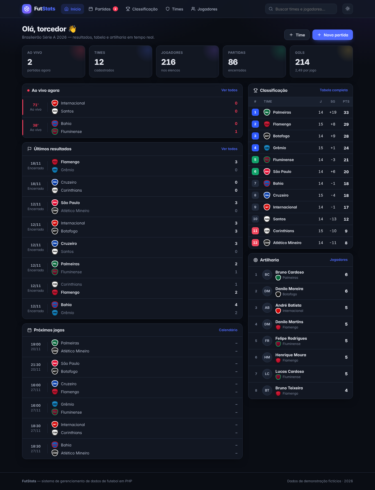
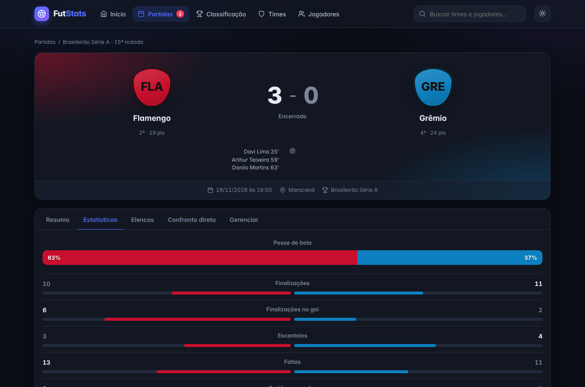
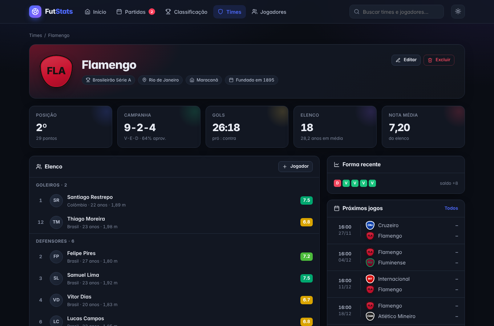

# FutStats

Sistema de gerenciamento de dados de futebol feito em **PHP puro**, com visual inspirado em apps de placar ao vivo (estilo SofaScore): tema escuro/claro, escudos gerados pelas cores do clube, placar ao vivo, timeline de eventos, estatísticas com barras e tabela de classificação calculada automaticamente.



| Partida | Time |
|---|---|
|  |  |

> Os clubes do banco de demonstração são reais, mas **jogadores, placares e estatísticas são fictícios**, gerados aleatoriamente para popular o sistema.

## ✨ Funcionalidades

| Módulo | O que faz |
|---|---|
| **Início** | Painel com partidas ao vivo, últimos resultados, próximos jogos, mini-tabela e artilharia |
| **Partidas** | Lista por rodada (com navegação ◀ ▶), filtros por status e por time, agrupamento por dia |
| **Página da partida** | Placar com cores dos times, marcadores, timeline (gols, pênaltis, gols contra, cartões), estatísticas (posse, finalizações, escanteios, faltas, cartões), elencos e confronto direto |
| **Gerenciar partida** | Registrar/remover gols e cartões com **atualização automática do placar**, editar e excluir a partida |
| **Classificação** | Calculada a partir dos jogos encerrados: pontos, V/E/D, gols, saldo, aproveitamento, últimos 5 jogos e zonas (Libertadores, Sul-Americana, rebaixamento). Colunas ordenáveis |
| **Times** | Cards com posição, pontos e forma; página do clube com elenco por posição, campanha, nota média e jogos |
| **Jogadores** | Busca, filtro por time e posição, tabela ordenável com gols, assistências e nota; página com estatísticas e participações |
| **CRUD completo** | Criar, editar e excluir times, jogadores, partidas e eventos (com validação) |
| **Extras** | Busca global, tema claro/escuro salvo no navegador, layout responsivo para celular |

## 🛠️ Tecnologias

- **PHP 8.1+** (sem frameworks, sem Composer)
- **SQLite** via PDO — o banco é criado e populado sozinho na primeira execução
- HTML + **CSS próprio** (variáveis CSS, grid, sem Bootstrap/Tailwind) + **JavaScript puro**
- Segurança: *prepared statements* em todas as consultas, escape de saída (`htmlspecialchars`) e token **CSRF** em todos os formulários

## 🚀 Como rodar

Requisitos: PHP 8.1 ou superior com a extensão `pdo_sqlite` habilitada (já vem ativa na maioria das instalações; no XAMPP/WAMP também).

```bash
git clone https://github.com/bimadevfull/futstats.git
cd futstats
php -S localhost:8000 -t public
```

Abra **http://localhost:8000** no navegador. Pronto! 🎉

**Usando XAMPP/WAMP/Laragon?** Coloque a pasta em `htdocs` (ou `www`) e acesse `http://localhost/futstats/public/`.

### Recriar o banco de demonstração

```bash
php database/reset.php
```

Para começar com o banco **vazio**, mude `'seed_demo' => false` em `config.php` e rode o comando acima.

## 📁 Estrutura

```
futstats/
├── config.php              # nome do app, caminho do banco, dados demo
├── public/                 # raiz web (único diretório exposto)
│   ├── index.php           # front controller / roteador
│   └── assets/
│       ├── css/style.css   # tema completo (escuro + claro)
│       └── js/app.js       # abas, ordenação, filtros, prévia de escudo…
├── src/
│   ├── bootstrap.php       # inicialização
│   ├── Database.php        # conexão PDO + criação automática do banco
│   ├── helpers.php         # escape, rotas, CSRF, flash, ícones, formatação
│   ├── repository.php      # consultas (times, jogadores, partidas, tabela)
│   ├── controllers.php     # páginas (GET)
│   └── actions.php         # ações de formulário (POST)
├── views/                  # templates PHP
│   └── partials/
└── database/
    ├── schema.sql          # tabelas
    ├── seed.php            # gerador de dados de demonstração
    └── reset.php           # recria o banco
```

### Rotas

Todas passam por `public/index.php?p=<rota>`:

- **GET** `p=pagina` → chama `page_pagina()` em `src/controllers.php`
- **POST** `p=acao` → valida o CSRF e chama `action_acao()` em `src/actions.php`

Para criar uma página nova, basta adicionar uma função `page_algo()` e uma view `views/algo.php`.

## 🗃️ Banco de dados

- `leagues` — competições
- `teams` — clubes (cores, estádio, cidade, fundação, técnico)
- `players` — jogadores (posição GOL/DEF/MEI/ATA, número, nascimento, altura, pé, nota)
- `matches` — partidas (status `scheduled` / `live` / `finished`, placar, minuto, estatísticas)
- `match_events` — gols, pênaltis, gols contra, cartões e assistências

A classificação e a artilharia **não são armazenadas**: são calculadas em tempo real a partir das partidas e eventos.

## 💡 Ideias para evoluir

- Login de administrador para proteger as telas de edição
- Upload de escudos e fotos de jogadores
- Suporte a MySQL (basta trocar o DSN em `src/Database.php` e adaptar o `schema.sql`)
- Importar dados reais de uma API de futebol
- Escalação titular por partida e notas por jogo

## 📄 Licença

MIT — use e modifique à vontade.
